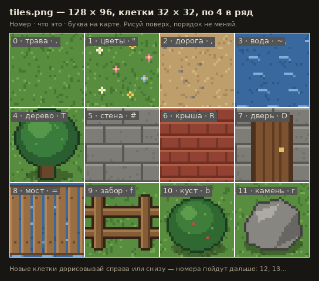
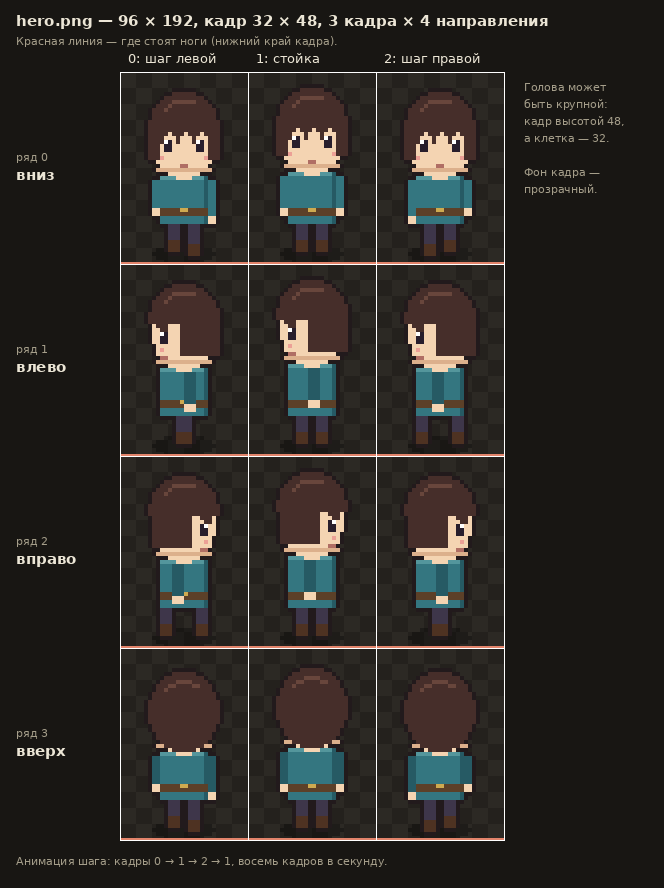

# Как рисовать графику для игры

Сейчас в игре три картинки-заглушки. Рисуешь свою **того же размера и с той же раскладкой**,
сохраняешь поверх заглушки и обновляешь страницу. Код трогать не нужно.

| Файл | Размер | Что это |
| --- | --- | --- |
| `client/public/assets/tiles.png` | 128 × 96 | клетки карты: трава, дорога, вода, стены… |
| `client/public/assets/hero.png` | 96 × 192 | персонаж: 4 направления × 3 кадра |
| `client/public/assets/aim.png` | 10 × 10 | стрелка прицела |

## Чем рисовать

- **Aseprite** — лучший редактор для пиксель-арта: слои, анимация, сетка. Платный (продаётся в Steam и на сайте).
- **LibreSprite** — бесплатная копия старой версии Aseprite, почти всё то же самое.
- **Piskel** — бесплатный, прямо в браузере на piskelapp.com, ничего ставить не надо. Для начала хватит.
- **Krita** — бесплатная, для рисованных от руки искажений. Понадобится на этапе 2.

В любом редакторе:

1. Инструмент — **карандаш**, не кисть, и без сглаживания.
2. Фон — **прозрачный** (кроме клеток карты: они заполняют квадрат целиком).
3. Экспорт — **PNG, масштаб 100 %**. Если редактор предлагает увеличить картинку при экспорте — не надо.

## Палитра и стиль

- Возьми одну готовую палитру на 16–32 цвета и рисуй только её цветами — так всё будет в одном стиле.
  Много готовых палитр на lospec.com, раздел Palette List.
- Обводка в 1 пиксель очень тёмным цветом (не чисто чёрным) делает персонажа читаемым на любом фоне.
- Свет падает сверху-слева: светлые пиксели — сверху и слева, тени — снизу и справа.

## Клетки карты — `tiles.png`

Сетка клеток 32 × 32, по 4 в ряд, сверху вниз. Номер клетки — её место в сетке.

| № | Что | Буква на карте | Можно пройти |
| --- | --- | --- | --- |
| 0 | трава | `.` | да |
| 1 | цветы | `"` | да |
| 2 | дорога | `,` | да |
| 3 | вода | `~` | нет |
| 4 | дерево | `T` | нет |
| 5 | каменная стена | `#` | нет |
| 6 | крыша | `R` | нет |
| 7 | дверь | `D` | нет (пока) |
| 8 | мост | `=` | да |
| 9 | забор | `f` | нет |
| 10 | куст | `b` | нет |
| 11 | камень | `r` | нет |

- Клетки стыкуются друг с другом: трава к траве, дорога к дороге. Края клетки должны продолжать
  противоположные края, иначе на земле проступит сетка. В Aseprite помогает режим **View → Tiled Mode** —
  он показывает клетку повторённой со всех сторон.
- Деревья, кусты, камни и забор рисуются прямо в своей клетке поверх травы.
- Нужна новая клетка (колодец, сундук, лавка)? Увеличь холст до 128 × 128 и рисуй в четвёртом ряду —
  номера пойдут дальше: 12, 13… Скажи мне, и я добавлю для неё букву на карте.

## Персонаж — `hero.png`

Кадр 32 × 48, в ряду 3 кадра, рядов 4.

- **Ряды:** 0 — идёт вниз (лицом к нам), 1 — влево, 2 — вправо, 3 — вверх (спиной).
- **Кадры:** 0 — шаг левой, 1 — стойка, 2 — шаг правой. На ходу игра крутит 0 → 1 → 2 → 1,
  8 кадров в секунду. Когда персонаж стоит, показывается кадр 1.
- **Ноги — у нижнего края кадра, по центру.** Игра ставит персонажа точкой «середина низа кадра».
  Полупрозрачная тень под ногами — можно.
- Кадр выше клетки (48 против 32), чтобы влезла крупная анимешная голова с причёской.
- Порядок работы: сначала стойка вниз (ряд 0, кадр 1), потом стойки в остальные стороны, потом шаги.
  Шаг отличается от стойки ногами и руками на 1–2 пикселя.
- Куда смотрит персонаж, решает мышь: он поворачивается к прицелу, даже когда идёт боком.

## Прицел — `aim.png`

10 × 10, стрелка смотрит **вправо**. Игра поворачивает её сама.

## Как проверить

1. Сохрани файл поверх заглушки в `client/public/assets/`.
2. Если игра запущена, обнови вкладку: **Ctrl+F5**. Игра сама зайдёт под твоим именем.
3. Видишь старую картинку — браузер взял её из памяти. Ещё раз Ctrl+F5.
4. Ошибся с размером — внизу справа появится красная плашка «С картинками что-то не так»,
   и в ней написано, какой размер нужен.

Схемы раскладки лежат в `docs/art/` — открой их рядом с редактором, чтобы не перепутать порядок.

## Что дальше: рисованные искажения

На этапе 2 появятся искажения от деградации — их ты рисуешь от руки, не пикселями:

- прозрачный PNG, размер — какой нужен (например, 256 × 256 для «пятна» морока);
- игра кладёт их поверх пиксельного мира и может масштабировать, поэтому рисуй с запасом по размеру;
- точный список картинок и их размеры дам, когда дойдём до этапа 2.
